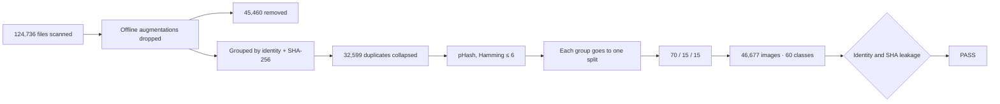

<p align="center">
  
</p>

<p align="center">
  <strong>Leak-free leaf recognition.</strong><br>
  Thirteen crops, sixty classes, one group split.<br>
  The same leaf is never in both train and test.
</p>

<p align="center">
  
  
  
  
  
  
</p>

<p align="center">
  
  
  
  
</p>

---

A dataset that reads crop and condition from a leaf photo, and the three EfficientNets trained on it.
While the sources were merged, offline augmentations were dropped, exact duplicates collapsed to a single example,
and near-duplicate frames were kept in the **same** train / val / test unit.

The best model is **EfficientNet-B2**. On the held-out test set, accuracy is **98.12%**, macro-F1 **94.94%**,
top-5 **99.37%**. Temperature scaling does not change accuracy; it corrects confidence.
Test ECE **31.03% → 1.34%**.

| | Train | Val | Test |
|---|---:|---:|---:|
| Images | 32,657 | 6,985 | 7,035 |
| Share | 70.0% | 15.0% | 15.1% |

**46,677** images in total. Seed `42`.

---

## What this solves

When the PlantVillage family folders (`2/`, `valid/`, `PlantVillage/`) and the crop pest / disease set
(`Train/`, `Validation/`) are merged into one name space, three things show up: augmentation copies,
pixel-identical files, and near-twins whose hash changed because of cropping or compression.
A random split then scores a sibling already seen in train, not a leaf the model has never seen.

This set closes that path.



The rules match `BUILD.md`:

- Offline augmentations are dropped. Suffixes `_180deg`, `_flip*`, `_newGRR`, `_new*deg*`, `_newPixel*`; prefixes `contrast_`, `rotation_`, and the like.
- Nested `PlantVillage/PlantVillage` is ignored.
- Group key: PlantVillage identity stem or crop file name, plus SHA-256.
- pHash near-duplicates (Hamming ≤ 6) share one split unit. **3,846** links.
- Each unit goes entirely into train, val, or test.
- Semantic merge on corn: Common rust, Gray leaf spot, healthy.
- A class whose total is under 100 is removed. If a crop’s healthy class is under 100, every class of that crop is removed.
- Single-crop blacklist classes, and rice from the old Train/Validation set, are always excluded.
- Rice comes only from the unaugmented originals inside `Rice_Leaf_AUG`. `aug_*` is dropped.

Representatives kept per source:

| Source | Images |
|---|---:|
| PlantVillage | 20,624 |
| `2/` | 15,353 |
| Train | 5,410 |
| valid | 3,830 |
| Rice_Leaf_AUG | 867 |
| Validation | 593 |

---

## Thirteen crops

Sixty classes, thirteen crops. Folder name `Crop___Condition`.

| Crop | Classes | Crop | Classes |
|---|---:|---|---:|
| Tomato | 10 | Apple | 4 |
| Wheat | 10 | Grape | 4 |
| Corn | 6 | Sugarcane | 4 |
| Rice | 6 | Potato | 3 |
| Cotton | 5 | Cherry, peach, pepper, strawberry | 2 each |

<details>
<summary>Full index of the sixty classes</summary>

| # | Class |
|---:|---|
| 0 | Apple · Apple scab |
| 1 | Apple · Black rot |
| 2 | Apple · Cedar apple rust |
| 3 | Apple · healthy |
| 4 | Cherry (including sour) · Powdery mildew |
| 5 | Cherry (including sour) · healthy |
| 6 | Corn · Common rust |
| 7 | Corn · Ear rot |
| 8 | Corn · Fall armyworm |
| 9 | Corn · Gray leaf spot |
| 10 | Corn · Northern Leaf Blight |
| 11 | Corn · healthy |
| 12 | Cotton · Aphid |
| 13 | Cotton · Bacterial blight |
| 14 | Cotton · Leaf curl |
| 15 | Cotton · Wilt |
| 16 | Cotton · healthy |
| 17 | Grape · Black rot |
| 18 | Grape · Esca (Black Measles) |
| 19 | Grape · Leaf blight (Isariopsis Leaf Spot) |
| 20 | Grape · healthy |
| 21 | Peach · Bacterial spot |
| 22 | Peach · healthy |
| 23 | Pepper, bell · Bacterial spot |
| 24 | Pepper, bell · healthy |
| 25 | Potato · Early blight |
| 26 | Potato · Late blight |
| 27 | Potato · healthy |
| 28 | Rice · Bacterial leaf blight |
| 29 | Rice · Brown spot |
| 30 | Rice · Leaf blast |
| 31 | Rice · Leaf scald |
| 32 | Rice · Sheath blight |
| 33 | Rice · healthy |
| 34 | Strawberry · Leaf scorch |
| 35 | Strawberry · healthy |
| 36 | Sugarcane · Mosaic |
| 37 | Sugarcane · Red rot |
| 38 | Sugarcane · Yellow rust |
| 39 | Sugarcane · healthy |
| 40 | Tomato · Bacterial spot |
| 41 | Tomato · Early blight |
| 42 | Tomato · Late blight |
| 43 | Tomato · Leaf Mold |
| 44 | Tomato · Septoria leaf spot |
| 45 | Tomato · Spider mites (two-spotted) |
| 46 | Tomato · Target Spot |
| 47 | Tomato · Tomato Yellow Leaf Curl Virus |
| 48 | Tomato · Tomato mosaic virus |
| 49 | Tomato · healthy |
| 50 | Wheat · Aphid |
| 51 | Wheat · Black rust |
| 52 | Wheat · Brown leaf rust |
| 53 | Wheat · Flag smut |
| 54 | Wheat · Leaf blight |
| 55 | Wheat · Mite |
| 56 | Wheat · Powdery mildew |
| 57 | Wheat · Scab |
| 58 | Wheat · Stem fly |
| 59 | Wheat · healthy |

Machine names live in `class_index.txt` and `labels.json`. Each record stores the crop, the disease, and which source folders it came from.

</details>

---

## Model

A `timm` EfficientNet backbone with the classification head removed and a four-layer MLP on top.
SiLU, BatchNorm, Dropout. ImageNet pretraining. The best checkpoint is chosen by **val macro-F1**.

| | |
|---|---|
| Backbones | `efficientnet_b0`, `efficientnet_b1`, `efficientnet_b2` |
| Epochs | 25, fixed hyperparameters |
| Image | 224, ImageNet mean and standard deviation |
| Batch | 64 |
| Learning rate | 3×10⁻⁴ |
| Weight decay | 1×10⁻⁴ |
| Label smoothing | 0.1 |
| MLP | `hidden_mult` 0.5, `drop_rate` 0.1 |
| Train sampling | class-balanced `WeightedRandomSampler` |
| Train transform | RandomResizedCrop (0.7–1.0), horizontal flip, ±15° rotation, ColorJitter |
| Val / test | short side 256, then a 224 center crop |
| Tracking | MLflow, experiment name `ultimate_plant_efficientnet_v1` |

Training requires CUDA. This run was on an RTX 5090. Inference also runs on CPU through ONNX.

### Test score

Numbers are from `runs/summary_test.csv`. Argmax metrics before temperature is applied.
Accuracy, F1, and top-k stay the same after calibration.

| Backbone | Accuracy | Macro-F1 | Weighted F1 | Top-3 | Top-5 | Kappa | ROC-AUC |
|---|---:|---:|---:|---:|---:|---:|---:|
| **B2** | **98.12%** | **94.94%** | **98.11%** | **99.26%** | **99.37%** | **0.981** | 0.978 |
| B0 | 97.58% | 93.33% | 97.56% | 99.18% | 99.43% | 0.975 | 0.981 |
| B1 | 94.64% | 90.00% | 94.69% | 98.39% | 98.66% | 0.945 | 0.972 |

B2, selected by val macro-F1, also leads on test. B0 is close on ROC-AUC and top-5. B1 trails on this set.

### Confidence

Temperature is fit on validation NLL only. The test set is not used. Inference is `softmax(logits / T)`.

| Backbone | T | Test ECE before | Test ECE after | Test NLL before | Test NLL after |
|---|---:|---:|---:|---:|---:|
| B0 | 0.481 | 31.40% | 1.47% | 0.517 | 0.163 |
| B1 | 0.540 | 30.03% | 2.19% | 0.608 | 0.297 |
| **B2** | **0.511** | **31.03%** | **1.34%** | **0.492** | **0.147** |

The exported graph has T baked in. The output is calibrated logits. `softmax` is enough; there is no second division.

| Format | B2 test accuracy | Where it ran |
|---|---:|---|
| `.pth` | 98.12% | CUDA |
| TorchScript `.pt` | 98.12% | CUDA |
| ONNX | 98.12% | CUDAExecutionProvider |
| TFLite float32 | 98.12% | CPU |
| TFLite float16 | failed to load | The CPU interpreter does not support float16 CONV |

---

## Field ID

The local UI uses B2 ONNX. Drop a photo in and the top four predictions come back as bars and a pie chart.
Labels are in Turkish: crop, disease or pest, and whether the leaf is healthy.

```powershell
cd infer_ui
.\start.ps1
```

The UI is at `http://127.0.0.1:5173`. The API health check is `http://127.0.0.1:8000/api/health`.

`runs/exported/efficientnet_b2/efficientnet_b2.onnx` must already be on disk.
Weights are not in the repository. Training and `python export_models.py` must have produced them on this machine,
or the file must be placed on that path by hand.

To run the two processes in separate windows:

```powershell
cd infer_ui\backend
python -m uvicorn main:app --host 127.0.0.1 --port 8000
```

```powershell
cd infer_ui\frontend
npm install
npm run dev -- --host 127.0.0.1 --port 5173
```

Preprocessing matches the training val/test path: short side 256, 224 center crop, ImageNet normalization.

---

## How to run

```powershell
python script1.py
python temperature_scaling.py --eval-test
python export_models.py
python test_best_model.py
python test_exported_formats.py
python audit_leakage.py
python audit_phash_stratification.py
```

| Piece | What it does |
|---|---|
| `script1.py` | Trains B0–B2, saves the val macro-F1 checkpoint, logs to MLflow |
| `temperature_scaling.py` | Fits T on val, with an optional test report |
| `export_models.py` | Writes `.pth`, `.pt`, `.onnx`, and `.tflite` with T baked in |
| `test_best_model.py` | Scores the selected model on test with the full metric set |
| `test_exported_formats.py` | Checks that the four formats agree on test |
| `audit_leakage.py` | Identity, SHA, path, and label consistency |
| `audit_phash_stratification.py` | Checks that near-duplicates stayed inside one split unit |
| `analiz.ipynb` | Exploration notes |
| `infer_ui/` | FastAPI + React UI |

Training dependencies: `torch`, `torchvision`, `timm`, `mlflow`, `numpy`, `pandas`, `pillow`, `scikit-learn`, `tqdm`.
Export also needs the ONNX and TFLite toolchains.
The UI backend dependencies are in `infer_ui/backend/requirements.txt`.
`HF_TOKEN` is optional. Without it, ImageNet weights still download, and the Hugging Face quota can fill sooner.

---

## What is in the repo, and what stays local

`.gitignore` is in place before the first commit. Images and weights do not come along in a clone.

| Stays on disk | Why |
|---|---|
| `train/`, `val/`, `test/` | About 3.1 GB of leaf images |
| `*.pt`, `*.pth`, `*.onnx`, `*.tflite` | About 840 MB of checkpoints and graphs |
| `mlruns/` | MLflow’s local store; training rewrites it |
| `node_modules/`, `__pycache__/`, `.venv/`, `.env` | Install, cache, secrets |

| Goes into the repo | Why |
|---|---|
| Code, `labels.json`, `class_index.txt`, `stats.json` | The dataset contract |
| `manifest.csv` | Per-image source trace, about 15 MB |
| `.csv`, `.json`, `.txt` under `runs/` | Scores, confusion matrix, temperature |
| `infer_ui` sources and `package-lock.json` | A UI that can be reinstalled |
| `BUILD.md` | Short record of the merge rules |

Images on this machine are hardlinks. Deleting a folder can also delete the source file. Copy before you move them.

---

<p align="center">
  
  &nbsp;
  
</p>

<p align="center">
  <sub>Group split · seed 42 · identity and SHA audit passed.</sub>
</p>
