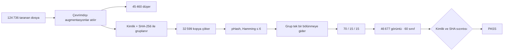

<p align="center">
  
</p>

<p align="center">
  <strong>Sızıntısız yaprak tanıma.</strong><br>
  On üç ürün, altmış sınıf, tek bir grup bölünmesi.<br>
  Aynı yaprak train’de de test’te de yok.
</p>

<p align="center">
  
  
  
  
  
  
</p>

<p align="center">
  
  
  
  
</p>

---

Yaprak fotoğrafından ürünü ve durumu okuyan bir veri seti ile onu eğiten üç EfficientNet.
Kaynaklar birleştirilirken çevrimdışı augmentasyonlar atıldı, birebir kopyalar tek örneğe indirildi
ve birbirine benzeyen kareler **aynı** train / val / test biriminde tutuldu.

En iyi model **EfficientNet-B2**. Tutulan test kümesinde doğruluk **%98.12**, macro-F1 **%94.94**,
top-5 **%99.37**. Sıcaklık ölçeklemesi doğruluğu değiştirmez; güveni düzeltir.
Test ECE **%31.03 → %1.34**.

| | Train | Val | Test |
|---|---:|---:|---:|
| Görüntü | 32 657 | 6 985 | 7 035 |
| Pay | %70.0 | %15.0 | %15.1 |

Toplam **46 677** görüntü. Tohum `42`.

---

## Ne çözülüyor

PlantVillage ailesi klasörleri (`2/`, `valid/`, `PlantVillage/`) ile ürün zararlısı / hastalık seti
(`Train/`, `Validation/`) aynı isim uzayında birleşince üç şey olur: augmentasyon kopyaları,
piksel piksel aynı dosyalar ve kırpma / sıkıştırma yüzünden hash’i değişmiş yakın ikizler.
Bunlar rastgele bölünürse test skoru, model görmediği bir yaprağı değil, train’deki kardeşini ölçer.

Bu set o yolu kapatır.



Kurallar, `BUILD.md` ile aynı:

- Çevrimdışı augmentasyonlar düşer. Sonekler `_180deg`, `_flip*`, `_newGRR`, `_new*deg*`, `_newPixel*`; önekler `contrast_`, `rotation_` ve benzerleri.
- İçi içe `PlantVillage/PlantVillage` yok sayılır.
- Grup anahtarı: PlantVillage kimlik kökü veya ürün dosya adı, artı SHA-256.
- pHash yakın kopyaları (Hamming ≤ 6) aynı bölünme birimini paylaşır. **3 846** bağlantı.
- Her birim train, val veya test’ten tam birine gider.
- Mısırda anlamsal birleşme: Common rust, Gray leaf spot, healthy.
- Toplamı 100’ün altında kalan sınıf silinir. Bir ürünün sağlıklı sınıfı 100’ün altındaysa o ürünün tüm sınıfları silinir.
- Tek ürünlük kara listedeki sınıflar ve eski Train/Validation pirinci her zaman dışarıda.
- Pirinç yalnız `Rice_Leaf_AUG` içindeki augmentasyonsuz orijinallerden gelir. `aug_*` düşer.

Kaynak başına tutulan temsilci:

| Kaynak | Görüntü |
|---|---:|
| PlantVillage | 20 624 |
| `2/` | 15 353 |
| Train | 5 410 |
| valid | 3 830 |
| Rice_Leaf_AUG | 867 |
| Validation | 593 |

---

## On üç tarla

Altmış sınıf, on üç ürün. Klasör adı `Ürün___Durum`.

| Ürün | Sınıf | Ürün | Sınıf |
|---|---:|---|---:|
| Domates | 10 | Elma | 4 |
| Buğday | 10 | Üzüm | 4 |
| Mısır | 6 | Şeker kamışı | 4 |
| Pirinç | 6 | Patates | 3 |
| Pamuk | 5 | Kiraz, şeftali, biber, çilek | 2’şer |

<details>
<summary>Altmış sınıfın tam dizini</summary>

| # | Sınıf |
|---:|---|
| 0 | Apple · Apple scab |
| 1 | Apple · Black rot |
| 2 | Apple · Cedar apple rust |
| 3 | Apple · healthy |
| 4 | Cherry (including sour) · Powdery mildew |
| 5 | Cherry (including sour) · healthy |
| 6 | Corn · Common rust |
| 7 | Corn · Ear rot |
| 8 | Corn · Fall armyworm |
| 9 | Corn · Gray leaf spot |
| 10 | Corn · Northern Leaf Blight |
| 11 | Corn · healthy |
| 12 | Cotton · Aphid |
| 13 | Cotton · Bacterial blight |
| 14 | Cotton · Leaf curl |
| 15 | Cotton · Wilt |
| 16 | Cotton · healthy |
| 17 | Grape · Black rot |
| 18 | Grape · Esca (Black Measles) |
| 19 | Grape · Leaf blight (Isariopsis Leaf Spot) |
| 20 | Grape · healthy |
| 21 | Peach · Bacterial spot |
| 22 | Peach · healthy |
| 23 | Pepper, bell · Bacterial spot |
| 24 | Pepper, bell · healthy |
| 25 | Potato · Early blight |
| 26 | Potato · Late blight |
| 27 | Potato · healthy |
| 28 | Rice · Bacterial leaf blight |
| 29 | Rice · Brown spot |
| 30 | Rice · Leaf blast |
| 31 | Rice · Leaf scald |
| 32 | Rice · Sheath blight |
| 33 | Rice · healthy |
| 34 | Strawberry · Leaf scorch |
| 35 | Strawberry · healthy |
| 36 | Sugarcane · Mosaic |
| 37 | Sugarcane · Red rot |
| 38 | Sugarcane · Yellow rust |
| 39 | Sugarcane · healthy |
| 40 | Tomato · Bacterial spot |
| 41 | Tomato · Early blight |
| 42 | Tomato · Late blight |
| 43 | Tomato · Leaf Mold |
| 44 | Tomato · Septoria leaf spot |
| 45 | Tomato · Spider mites (two-spotted) |
| 46 | Tomato · Target Spot |
| 47 | Tomato · Tomato Yellow Leaf Curl Virus |
| 48 | Tomato · Tomato mosaic virus |
| 49 | Tomato · healthy |
| 50 | Wheat · Aphid |
| 51 | Wheat · Black rust |
| 52 | Wheat · Brown leaf rust |
| 53 | Wheat · Flag smut |
| 54 | Wheat · Leaf blight |
| 55 | Wheat · Mite |
| 56 | Wheat · Powdery mildew |
| 57 | Wheat · Scab |
| 58 | Wheat · Stem fly |
| 59 | Wheat · healthy |

Makine adları `class_index.txt` ve `labels.json` içindedir. Her kayıt ürün, hastalık ve hangi kaynak klasörlerden geldiğini tutar.

</details>

---

## Model

`timm` EfficientNet omurga, sınıflandırma başlığı kesik, üstüne dört katmanlı MLP.
SiLU, BatchNorm, Dropout. ImageNet ön-eğitimi. En iyi kontrol noktası **val macro-F1**.

| | |
|---|---|
| Omurgalar | `efficientnet_b0`, `efficientnet_b1`, `efficientnet_b2` |
| Epok | 25, sabit hiperparametre |
| Görüntü | 224, ImageNet ortalama ve standart sapma |
| Batch | 64 |
| Öğrenme oranı | 3×10⁻⁴ |
| Weight decay | 1×10⁻⁴ |
| Label smoothing | 0.1 |
| MLP | `hidden_mult` 0.5, `drop_rate` 0.1 |
| Train örnekleme | sınıf dengesine göre `WeightedRandomSampler` |
| Train dönüşüm | RandomResizedCrop (0.7–1.0), yatay çevirme, ±15° döndürme, ColorJitter |
| Val / test | kısa kenar 256, sonra 224 center crop |
| İzleme | MLflow, deney adı `ultimate_plant_efficientnet_v1` |

Eğitim CUDA ister. Bu çalışma RTX 5090 üzerinde koştu. Çıkarım ONNX ile CPU’da da yürür.

### Test skoru

Sayılar `runs/summary_test.csv` dosyasından. Sıcaklık uygulanmadan önceki argmax metrikleri.
Doğruluk, F1 ve top-k kalibrasyondan sonra da aynı kalır.

| Omurga | Doğruluk | Macro-F1 | Ağırlıklı F1 | Top-3 | Top-5 | Kappa | ROC-AUC |
|---|---:|---:|---:|---:|---:|---:|---:|
| **B2** | **98.12%** | **94.94%** | **98.11%** | **99.26%** | **99.37%** | **0.981** | 0.978 |
| B0 | 97.58% | 93.33% | 97.56% | 99.18% | 99.43% | 0.975 | 0.981 |
| B1 | 94.64% | 90.00% | 94.69% | 98.39% | 98.66% | 0.945 | 0.972 |

Val makro-F1 ile seçilen B2, testte de önde. B0, ROC-AUC ve top-5’te yarışır. B1 bu sette geride kalır.

### Güven

Sıcaklık yalnız validation NLL üzerinde bulunur, teste bakılmaz. Çıkarım: `softmax(logits / T)`.

| Omurga | T | Test ECE önce | Test ECE sonra | Test NLL önce | Test NLL sonra |
|---|---:|---:|---:|---:|---:|
| B0 | 0.481 | 31.40% | 1.47% | 0.517 | 0.163 |
| B1 | 0.540 | 30.03% | 2.19% | 0.608 | 0.297 |
| **B2** | **0.511** | **31.03%** | **1.34%** | **0.492** | **0.147** |

Dışa aktarılan grafikte T gömülüdür. Çıktı kalibre logit’tir. `softmax` yeter, ikinci bir bölme yok.

| Biçim | B2 test doğruluğu | Nerede koştu |
|---|---:|---|
| `.pth` | 98.12% | CUDA |
| TorchScript `.pt` | 98.12% | CUDA |
| ONNX | 98.12% | CUDAExecutionProvider |
| TFLite float32 | 98.12% | CPU |
| TFLite float16 | yüklenmedi | CPU yorumlayıcısı float16 CONV desteklemiyor |

---

## Tarla tanı

Yerel arayüz B2 ONNX kullanır. Fotoğraf sürüklenir, ilk dört tahmin çubuk ve pasta olarak gelir.
Etiketler Türkçedir: ürün, hastalık veya zararlı, sağlıklı ayrımı.

```powershell
cd infer_ui
.\start.ps1
```

Arayüz `http://127.0.0.1:5173`. API `http://127.0.0.1:8000/api/health`.

Önkoşul: `runs/exported/efficientnet_b2/efficientnet_b2.onnx` diskte olsun.
Ağırlıklar depoya girmez. Eğitim ve `python export_models.py` aynı makinede üretmiş olmalı
ya da dosya elle bu yola konmalı.

Ayrı pencereler için:

```powershell
cd infer_ui\backend
python -m uvicorn main:app --host 127.0.0.1 --port 8000
```

```powershell
cd infer_ui\frontend
npm install
npm run dev -- --host 127.0.0.1 --port 5173
```

Ön işleme eğitimdeki val/test yolu ile aynıdır: kısa kenar 256, 224 center crop, ImageNet normalizasyonu.

---

## Çalıştırma

```powershell
python script1.py
python temperature_scaling.py --eval-test
python export_models.py
python test_best_model.py
python test_exported_formats.py
python audit_leakage.py
python audit_phash_stratification.py
```

| Parça | Ne yapar |
|---|---|
| `script1.py` | B0–B2 eğitimi, val macro-F1 kontrol noktası, MLflow |
| `temperature_scaling.py` | T’yi val’de oturtur, isteğe bağlı test raporu |
| `export_models.py` | T gömülü `.pth`, `.pt`, `.onnx`, `.tflite` |
| `test_best_model.py` | Seçilen modeli testte geniş metrik ile ölçer |
| `test_exported_formats.py` | Dört biçimin testte örtüştüğünü doğrular |
| `audit_leakage.py` | Kimlik, SHA, yol ve etiket tutarlılığı |
| `audit_phash_stratification.py` | Yakın kopyaların bölünme birimini bozmadığını yoklar |
| `analiz.ipynb` | Keşif notları |
| `infer_ui/` | FastAPI + React arayüzü |

Eğitim bağımlılıkları: `torch`, `torchvision`, `timm`, `mlflow`, `numpy`, `pandas`, `pillow`, `scikit-learn`, `tqdm`.
Dışa aktarma ek olarak ONNX ve TFLite araçlarını ister.
Arayüz backend’i `infer_ui/backend/requirements.txt` içindedir.
`HF_TOKEN` isteğe bağlıdır. Yoksa ImageNet ağırlıkları yine iner, Hugging Face kotası daha çabuk dolabilir.

---

## Depoda ne var, ne yok

`.gitignore` ilk commit’ten önce durur. Görüntüler ve ağırlıklar klona binmez.

| Diskte kalır | Neden |
|---|---|
| `train/`, `val/`, `test/` | Yaklaşık 3.1 GB yaprak görüntüsü |
| `*.pt`, `*.pth`, `*.onnx`, `*.tflite` | Yaklaşık 840 MB kontrol noktası ve grafik |
| `mlruns/` | MLflow’un yerel deposu, eğitim yeniden yazar |
| `node_modules/`, `__pycache__/`, `.venv/`, `.env` | Kurulum, önbellek, gizli anahtar |

| Depoya girer | Neden |
|---|---|
| Kod, `labels.json`, `class_index.txt`, `stats.json` | Setin sözleşmesi |
| `manifest.csv` | Görüntü başına kaynak izi, yaklaşık 15 MB |
| `runs/` altındaki `.csv`, `.json`, `.txt` | Skor, karışıklık matrisi, sıcaklık |
| `infer_ui` kaynakları ve `package-lock.json` | Arayüzün yeniden kurulabilir hali |
| `BUILD.md` | Birleştirme kurallarının kısa kaydı |

Görüntüler bu makinede hardlink. Klasörleri silmek kaynak dosyayı da düşürebilir. Taşımadan önce kopyalayın.

---

<p align="center">
  
  &nbsp;
  
</p>

<p align="center">
  <sub>Grup bölünmesi · tohum 42 · kimlik ve SHA denetimi geçti.</sub>
</p>
